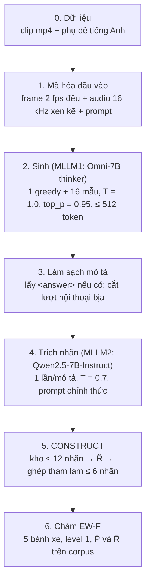

# F1 / CONSTRUCT: pipeline chi tiết và toàn bộ bottleneck (2026-11-28)

Phạm vi: cấu hình P17 trên OV-MERD+ (532 clip, Qwen2.5-Omni-7B zero-shot, extractor chính thức).

Mọi số đo trong file này đều **không dùng nhãn**, trừ các dòng đánh dấu "(đã công bố trong P17)".
- Script: `explore/ovmer/p17_diag_labelfree.py` và `p17_diag_search_gap.py`; kết quả ở `explore/ovmer/p17_diag_2026-11-27.md`.
- Các số đo bổ sung ngày 28/11 được chạy inline trên cùng output.

---

## 1. Pipeline

### Bước 0. Dữ liệu
- 532 clip OV-MERD+ lấy từ `MERChallenge/MER2026` (`video_track2_train_human`). Nhãn chuẩn lấy từ file CSV chính thức trong repo AffectGPT.
- Phụ đề **tiếng Anh**, giống code chính thức (`ovmerdplus_dataset.py` dòng 74). Phim gốc nói tiếng Trung.

### Bước 1. Mã hóa đầu vào (`p17_describe.py`, `qwen_omni_utils` 0.0.9)
- **Hình:**
  - frame chọn bằng `torch.linspace` đều trên toàn clip, mục tiêu 2 fps (`FPS = 2.0`);
  - số frame là bội của 2 (`FRAME_FACTOR = 2`), trong khoảng 4–768;
  - mỗi frame được resize theo ngân sách pixel mặc định.
- **Tiếng:** ffmpeg giải mã track audio ra wav, rồi `librosa.load(sr = 16000)` mono. Processor nhận `load_audio_from_video = True`, nên audio **xen kẽ theo thời gian** với frame.
- **Prompt:**
  - system prompt mặc định của Qwen-Omni;
  - user prompt chính thức của OV-MER: *"Subtitle content of the video: {sub} As an expert in the field of emotions, please focus on the facial expressions, body movements, environment, subtitle content, etc., … provide a detailed description and ultimately predict the emotional state …"*.
- Độ dài prompt: median 1.634 token.
- **Cả 17 lần sinh dùng đúng cùng một đầu vào.**

### Bước 2. Sinh mô tả (MLLM1)
- Qwen2.5-Omni-7B, chỉ khối thinker, bf16, transformers 5.24.0, 1× A100 40 GB.
- 1 lần greedy (`do_sample = False`).
- 16 mẫu lấy theo kiểu ancestral sampling (T = 1,0, top_p = 0,95), sinh theo lô ≤ 8 chuỗi (`num_return_sequences`), seed torch 1000 + s.
- Tối đa 512 token mới. Thời gian khoảng 46 giây/clip.

### Bước 3. Làm sạch mô tả (đăng ký trước, P17)
- Nếu có thẻ `<answer>…</answer>` thì chỉ lấy phần trong thẻ (theo code chính thức).
- Cắt ở lượt hội thoại bịa đầu tiên. Regex bắt `Human:`, `User:`, `Assistant:`, `用户:`, `助手:` và `<|im_start|>`.

### Bước 4. Trích nhãn (MLLM2)
- Qwen2.5-7B-Instruct, vLLM, bf16, chỉ một user message.
- Prompt `reason_to_openset_qwen` của AffectGPT-RL, có câu *"at most four labels"*.
- T = 0,7, top_p = 0,8, repetition penalty 1,05, max 512, seed 0.
- Hậu xử lý: `func_postprocess_qwen` → `string_to_list` → `parse` (dòng đầu, tách theo dấu phẩy, viết thường, ≤ 8 nhãn).
- Mỗi mô tả trích **1 lần**. Kết quả: S₀ (greedy) và S₁…S₁₆.

### Bước 5. CONSTRUCT (`p13_mbr.construct`, đóng băng 23/11)
1. **Kho:** các nhãn trong từ vựng bánh xe, xếp theo số mẫu có chứa nhãn. Nhãn greedy được thêm với tần suất 0. Lấy 12 nhãn đầu.
2. **Mục tiêu:**
   - R̂(Y) = trung bình trên các mẫu không rỗng của `sample_f(Sᵢ, Y)`;
   - `sample_f` là F theo nhóm của một clip, trung bình trên các bánh xe mà Sᵢ có nhóm;
   - mẫu chỉ chứa từ ngoài từ vựng cho 0 với mọi Y.
3. **Tìm:** thêm từng nhãn làm R̂ tăng nhiều nhất. Dừng khi không tăng hoặc đã có 6 nhãn.
4. **Dự phòng:** nếu tập rỗng thì lấy nhãn đầu kho; nếu kho rỗng thì lấy danh sách greedy.

### Bước 6. Chấm (`ew_metric.py`, khớp code chính thức)
- **Quy nhãn về nhóm:** nhãn → `format_mapping` → `raw_mapping` → nhóm level 1 trên từng bánh xe. Mỗi nhãn chỉ lấy **một** nhóm: dạng gốc đầu tiên theo thứ tự chữ cái có trong bánh xe. Nhãn không có trong `format_mapping` bị bỏ.
- **Tính điểm:** với mỗi bánh xe, tính P̄ và R̄ trung bình trên các clip mà GT có nhóm. Dự đoán rỗng tính P = R = 0. Tính F(P̄, R̄), rồi lấy trung bình 5 bánh xe.

---

## 2. Toàn bộ bottleneck

**Cột "Dư địa"** là [Đánh giá] của người viết, dựa trên số đo trong cùng dòng:
- *không đáng kể*: đã đo, dưới 0,1 điểm hoặc tương đương;
- *nhỏ*: dưới 0,5;
- *vừa*: 0,5–2;
- *lớn*: trên 2;
- *chưa đo*: chưa có số.

**Cột "Số đo"** là [Sự thật] trên output P17, trừ chỗ ghi khác.

### A. Đầu vào (bước 0–1)

| ID | Bottleneck | Số đo | Dư địa | Hướng xử lý |
|---|---|---|---|---|
| A1 | Mọi mẫu dùng cùng một đầu vào, nên không có đa dạng theo góc nhìn hay modality | Đúng theo code: cùng frame, cùng audio, cùng phụ đề | chưa đo | View sampling, ví dụ bỏ bớt một modality (mục 3) |
| A2 | Frame lấy đều 2 fps; không ưu tiên đoạn có biểu cảm mạnh | Theo code | chưa đo | Chọn frame theo khuôn mặt hoặc đoạn có chuyển động |
| A3 | Ngân sách pixel mỗi frame; mặt người có thể nhỏ | Chưa đo kích thước mặt | chưa đo | Crop mặt làm thêm một góc nhìn |
| A4 | Phụ đề tiếng Anh dịch từ lời thoại tiếng Trung; mất sắc thái | Theo protocol chính thức. Pilot 3B dùng tiếng Trung, nhưng khác cả extractor nên không so được | chưa đo | Giữ tiếng Anh để so với số đã công bố; thử tiếng Trung như một góc nhìn |

### B. Sinh mô tả (bước 2–3)

| ID | Bottleneck | Số đo | Dư địa | Hướng xử lý |
|---|---|---|---|---|
| B1 | **Prior và lỗi hệ thống của MLLM1** (q ≠ p) | Không đo được nếu không dùng nhãn. Khoảng cách CONSTRUCT 68,91 so với oracle tập con 91,48 (đã công bố trong P17) chủ yếu nằm ở đây, cộng với C và D | **lớn** | Tín hiệu xác suất hoặc tự kiểm chứng (P18) |
| B2 | **Lấy mẫu thoái hóa: 21,1% mẫu chạy hết 512 token mà không kết thúc** (kể chuyện bịa, lặp "Human Human …") | Trong nhóm này, 32,1% mẫu rỗng sau khi trích và 16,2% chỉ có từ ngoài từ vựng, tổng **48%** mất trắng. Mẫu kết thúc bình thường: 6,9% và 3,0% | **vừa** (đánh giá: mất khoảng 2,2/16 mẫu mỗi clip, tác dụng như giảm N, cộng thêm nhiễu) | Hạ T, dùng min-p hoặc ε-sampling, phạt lặp, dừng ở token kết thúc lượt; quét trên dev |
| B3 | Mô hình tự bịa lượt hội thoại | 75,2% mẫu và 95,7% mô tả greedy. Sau khi cắt, độ dài median từ 2.114 còn 949 ký tự | nhỏ (luật cắt đã xử lý; chỉ 9,5% đoạn trước lượt bịa thiếu dấu câu cuối) | Thêm `<|im_end|>` / "Human" vào stop string, đỡ tốn token |
| B4 | Đa dạng giữa các mẫu chủ yếu đến từ MLLM1 | Chiếm 79,4% độ bất đồng giữa các mẫu (độ khớp giữa hai mô tả khác nhau: 0,527) | — | Đây là phần thông tin có ích; xử lý bằng N và trọng số mẫu (C3, D2) |
| B5 | Mô tả tự do là kênh có mất mát: cảm xúc được nói gián tiếp ("giọng run"), extractor phải tự suy luận | Chưa tách được | chưa đo | Hỏi thẳng nhãn, hoặc chấm xác suất nhãn (bỏ kênh mô tả) |
| B6 | Chi phí: 17 chuỗi, khoảng 46 giây/clip | Đã đo | — (điểm yếu khi so với các mô hình chỉ sinh 1 lần) | N thích nghi; báo đường cong chất lượng theo chi phí |
| B7 | Seed lấy mẫu của MLLM1 | Chưa đo | chưa đo | `describe_seeds` (3 seed) |

### C. Trích nhãn (bước 4)

| ID | Bottleneck | Số đo | Dư địa | Hướng xử lý |
|---|---|---|---|---|
| C1 | **Nhiễu riêng của extractor** (T = 0,7, trích 1 lần) | Chiếm 20,6% độ bất đồng giữa các mẫu. Hai lần trích cùng một mô tả ra cùng tập nhãn ở 77,1% số lần | nhỏ đến vừa (đổi seed extractor: 68,91 → 69,01) | Trích greedy, hoặc trích K lần rồi lấy trung bình |
| C2 | **Mẫu rỗng sau khi trích** | 12,2% tổng số mẫu, phần lớn từ các mẫu thoái hóa (B2) | vừa (gộp với B2) | Sửa B2 trước |
| C3 | **Mẫu chỉ có từ ngoài từ vựng** | 5,8% số mẫu; 25,6% số từ khác nhau nằm ngoài từ vựng (*neutral* 190, *resigned* 61, *friendly* 41, *down* 30, *tension* 29, *on edge* 22, *conflicted* 19) | nhỏ đến vừa | Ánh xạ tự động sang từ trong từ vựng gần nghĩa nhất, không dùng GT. Tiền lệ: NORM_MAP viết tay của MultiMER |
| C4 | Câu "at most four labels" | Số nhóm mỗi mẫu 1,38 ở cả hai prompt; chỉ phần >4 nhãn giảm (8,6% → 3,3%). Prompt cũ: 69,13 so với 68,91 (đã công bố trong P17) | nhỏ | Giữ prompt chính thức |
| C5 | Prior riêng của extractor (diễn giải lại, gom hay tách nhãn) | Chưa tách được | chưa đo | Thử extractor khác như một biến thể; hoặc bỏ extractor |
| C6 | `parse` chỉ lấy dòng đầu và tối đa 8 nhãn | Đầu ra của extractor đã bị xóa xuống dòng | không đáng kể | — |

### D. CONSTRUCT (bước 5)

| ID | Bottleneck | Số đo | Dư địa | Hướng xử lý |
|---|---|---|---|---|
| D1 | **Tín hiệu chọn chỉ là độ đồng thuận giữa các mẫu** | Oracle chọn 1 mẫu: 84,73; oracle tập con: 91,48; CONSTRUCT: 68,91 (đã công bố trong P17) | **lớn** (gộp với B1) | P18: P(Yes) hoặc log-likelihood từng nhãn, đưa vào R̂ |
| D2 | **Mọi mẫu có trọng số như nhau**, kể cả mẫu thoái hóa | Mẫu thoái hóa: 21,1% (B2) | vừa | Trọng số theo độ đồng thuận, theo trạng thái kết thúc, hoặc theo tự kiểm chứng |
| D3 | **Sai số Monte Carlo** | N′ trung bình 14,0, thấp nhất 7. Từ 8 lên 16 mẫu: +1,17 (đã công bố trong P17) | vừa (đắt) | Tăng N; hoặc giảm phương sai: Rao–Blackwell hóa extractor, dùng xác suất thay cho đếm |
| D4 | **Reference thưa nên tập dự đoán bị neo ở mật độ thấp** | 1,38 nhóm/mẫu; tập CONSTRUCT trung bình 2,35 nhãn (phân bố 1: 107, 2: 217, 3: 143, 4: 48, 5: 14, 6: 3); GT 3,84 nhãn/clip (OV-MERD+), 6,23 (MER2025-FG). Trên MER2025-FG (3B), CONSTRUCT thua MultiMER −1,73 với P 73 / R 60 | nhỏ trên OV-MERD+ (CONSTRUCT-D chỉ +0,16); **vừa đến lớn** trên tập có nhãn dày | U2: reference là hợp của m mẫu; U1 |
| D5 | **Utility là F của từng clip, trong khi metric là F của trung bình corpus** | Bảng ví dụ ở report v2, mục 3.2 | nhỏ trên OV-MERD+ | U1: utility tuyến tính hóa theo corpus, không dùng nhãn |
| D6 | Cùng một bộ mẫu vừa làm ứng viên vừa làm reference | Thiết kế hiện tại | chưa đo | Tách hai vai: ứng viên lấy rộng, reference lấy đúng phân phối |
| D7 | Giới hạn kho 12 nhãn, xếp theo tần suất từ | Kho bị cắt ở 71,8% số clip, nhưng bỏ giới hạn chỉ làm R̂ tăng 0,0008 và đổi tập chọn ở 10,2% số clip | không đáng kể | — |
| D8 | Tìm kiếm tham lam | Đạt đúng tối ưu vét cạn ở 97,0% số clip; chênh R̂ trung bình 0,0002 | không đáng kể | — |
| D9 | Trần 6 nhãn | Chỉ 3/532 clip chạm trần | không đáng kể | — |
| D10 | N, M, K (16 / 12 / 6) và T chưa chỉnh | Theo thiết kế | chưa đo | Chỉnh trên dev |

### E. Chấm điểm và protocol (bước 6)

| ID | Bottleneck | Số đo | Dư địa | Hướng xử lý |
|---|---|---|---|---|
| E1 | **Tập test nhỏ (532 clip):** khó chứng minh chênh lệch nhỏ | Sai số chuẩn ghép cặp khoảng 0,37; MDE khoảng 1 | — (giới hạn khi viết bài) | Kiểm định gộp trên 3 tập, đăng ký trước |
| E2 | **Chưa có tập dev cho mô hình 7B** | MER2025-FG chưa sinh mô tả | — (**chặn mọi bước chỉnh**) | Chạy describe MER2025-FG (khoảng 12,5 giờ GPU) |
| E3 | Mỗi nhãn chỉ quy về một nhóm (theo thứ tự chữ cái); từ ngoài từ vựng bị bỏ ở cả GT lẫn dự đoán | Theo code chính thức | — (đặc tính của metric; giữ nguyên) | Không sửa metric |
| E4 | Khó so sánh với số đã công bố: AffectGPT-R1 chọn checkpoint trên test; MER-R1 bỏ qua extractor; ta cắt lượt bịa | Đã ghi trong report v2, Phụ lục C | — | Nêu rõ trong bài |
| E5 | Mới có 1 seed lấy mẫu | — | — | 3 seed trên OV-MERD+ |

---

## 3. Đọc tổng thể

[Đánh giá]
1. **Điểm nghẽn thật nằm ở thượng nguồn của R̂:** B1/D1 (tín hiệu chọn), B2 (lấy mẫu thoái hóa), D2 và D3 (trọng số mẫu và sai số Monte Carlo). Tìm kiếm và kho ứng viên (D7–D9) đã gần tối ưu.
2. **B2 là phát hiện mới, rẻ nhất để sửa:** 21% mẫu thoái hóa, và gần một nửa trong số đó không đóng góp nhãn nào. Sửa lấy mẫu (hạ T, min-p, stop string) cộng trọng số mẫu (D2) là bước có tỉ lệ lợi ích trên chi phí cao nhất. Nhưng sửa lấy mẫu **phải sinh lại mô tả**, nên phải làm trên dev.
3. **D4 và D5 quan trọng cho tổng quát hóa sang tập nhãn dày,** không phải để vượt SOTA trên OV-MERD+.
4. **Thứ tự** (mọi bước trên dev MER2025-FG):
   - (i) sinh mô tả cho dev, đồng thời quét cấu hình lấy mẫu trên 300 clip con (B2, B3);
   - (ii) chỉ dùng CPU và vLLM: C1, C3, D2, D4, D5;
   - (iii) P18 bằng prefill (B1, D1);
   - (iv) view sampling (A1–A3).
