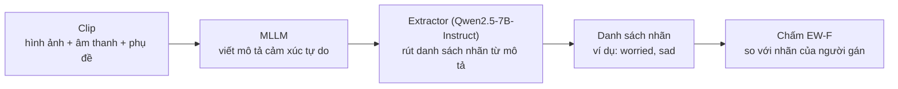
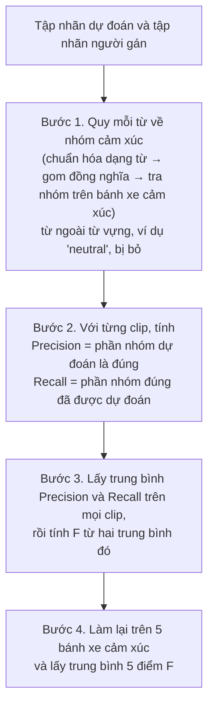
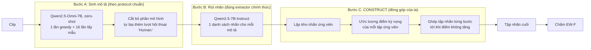
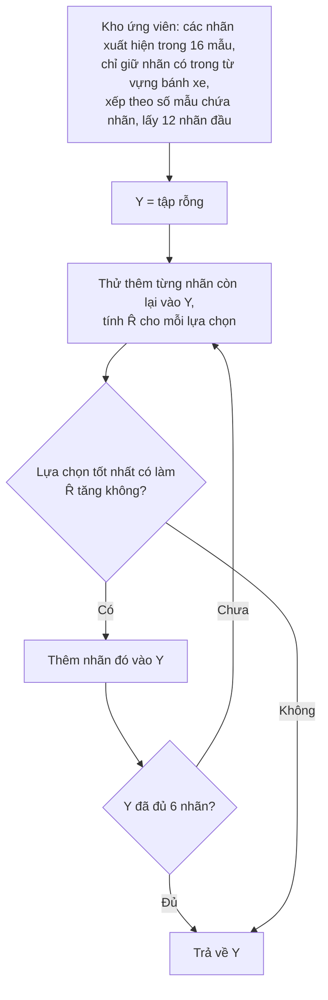
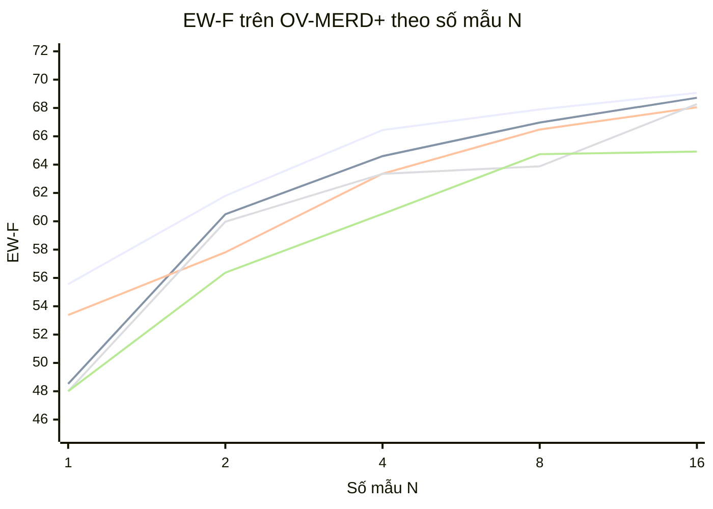
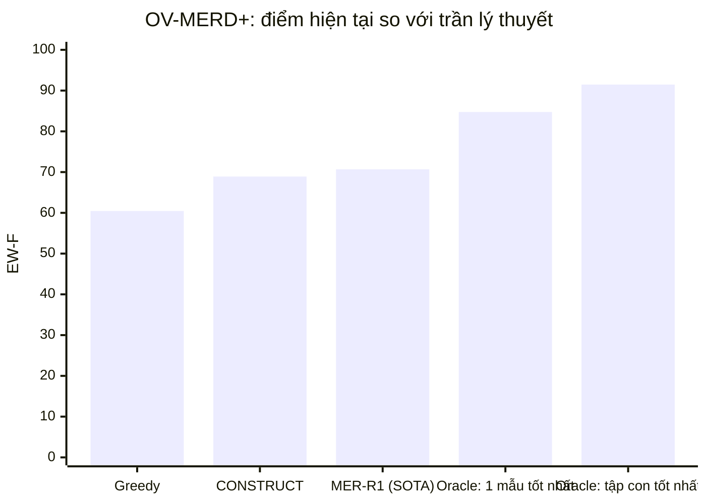
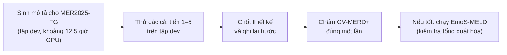

# CONSTRUCT: Giải mã tập nhãn cảm xúc không cần huấn luyện cho nhận diện cảm xúc đa phương thức từ vựng mở

*Báo cáo kỹ thuật nội bộ. Số liệu tính đến 26/11/2026. Tên bài là tên tạm.*

> **Đọc nhanh (5 ý chính)**
> 1. **Bài toán.** Cho một video clip, mô hình phải trả về một *tập* từ chỉ cảm xúc, ví dụ {lo lắng, buồn}. Điểm được chấm bằng EW-F, một thước đo so khớp theo *nhóm cảm xúc*.
> 2. **Vấn đề.** Mô hình chỉ sinh *một* câu trả lời mỗi lần, và câu trả lời đó dao động ngẫu nhiên. Các phương pháp mạnh nhất phải huấn luyện thêm bằng reinforcement learning (RL), rất tốn kém.
> 3. **Đề xuất.** CONSTRUCT hỏi mô hình nhiều lần, rồi *ghép* ra tập nhãn có điểm EW-F kỳ vọng cao nhất. Không huấn luyện gì.
> 4. **Kết quả.** Trên benchmark OV-MERD+, CONSTRUCT nâng mô hình 7B zero-shot từ **60,46 lên 68,91**. Con số này cao hơn hai mô hình AffectGPT đã huấn luyện, nhưng còn kém SOTA MER-R1 (**70,68**). Khi dùng 16 mẫu, CONSTRUCT ngang với cách gộp tốt nhất đã công bố; khi dùng ít mẫu, nó vượt.
> 5. **Hướng tiếp.** Các mẫu của mô hình đã chứa tập nhãn đạt tới **91,48** điểm. Cái còn thiếu là tín hiệu để *chọn* nhãn. Bước tiếp theo là để mô hình tự kiểm chứng từng nhãn.

---

## Mục lục

1. [Giới thiệu](#1-giới-thiệu)
2. [Bối cảnh và công trình liên quan](#2-bối-cảnh-và-công-trình-liên-quan)
3. [Bài toán và cách chấm điểm](#3-bài-toán-và-cách-chấm-điểm)
4. [Phương pháp CONSTRUCT](#4-phương-pháp-construct)
5. [Thiết lập thực nghiệm](#5-thiết-lập-thực-nghiệm)
6. [Kết quả](#6-kết-quả)
7. [Hạn chế và hướng cải tiến](#7-hạn-chế-và-hướng-cải-tiến)
8. [Kết luận](#8-kết-luận)
- [Phụ lục A. Thuật ngữ](#phụ-lục-a-thuật-ngữ)
- [Phụ lục B. Ví dụ tính tay đầy đủ](#phụ-lục-b-ví-dụ-tính-tay-đầy-đủ)
- [Phụ lục C. Protocol và các điểm lệch so với bản chính thức](#phụ-lục-c-protocol-và-các-điểm-lệch-so-với-bản-chính-thức)
- [Tài liệu tham khảo](#tài-liệu-tham-khảo)

---

## 1. Giới thiệu

### 1.1. Bài toán qua một ví dụ

Một clip phim dài 4 giây: người đàn ông cau mày, giọng run, phụ đề *"Tôi không biết phải nói với cô ấy thế nào."* Người gán nhãn ghi lại: **{lo lắng, buồn}**.

Đây là bài toán **open-vocabulary multimodal emotion recognition (OV-MER)**:
- **đầu vào** có ba phương thức: hình ảnh, âm thanh, phụ đề;
- **đầu ra** là một **tập từ cảm xúc tự do**, không giới hạn trong vài lớp cố định như "vui / buồn / giận".

Từ năm 2025 các challenge MER chuyển hẳn sang dạng bài này. Bài tổng kết MER2026 gọi đây là bước chuyển *"from discriminative emotion recognition to generative emotion understanding"*.

### 1.2. Vì sao "hỏi một lần" là chưa đủ

Mô hình đa phương thức lớn (MLLM) trả lời bằng cách sinh văn bản, và câu trả lời dao động ngẫu nhiên. Hỏi cùng một clip bốn lần có thể nhận được:

| Lần hỏi | Mô hình trả lời |
|---|---|
| 1 | lo lắng, buồn, **tức giận** |
| 2 | lo lắng, buồn, **ngạc nhiên** |
| 3 | lo lắng, buồn, **vui** |
| 4 | lo lắng, buồn, **ghê sợ** |

Lần nào cũng đúng phần cốt lõi {lo lắng, buồn}, nhưng kèm một nhãn "lạc" khác nhau. Nếu chỉ lấy một câu trả lời, ta *luôn* dính một nhãn sai. Nếu nhìn cả bốn, ta thấy ngay phần các lần cùng đồng ý.

### 1.3. Ý tưởng

**CONSTRUCT** hỏi mô hình N lần (N = 16), rồi tự **ghép** một tập nhãn sao cho, *tính trung bình trên N câu trả lời*, tập đó đạt điểm cao nhất theo đúng cách benchmark chấm. Trong ví dụ trên, CONSTRUCT trả về {lo lắng, buồn}: một tập *không có trong bốn câu trả lời nào*, nhưng là đáp án tốt nhất (tính chi tiết ở mục 4.5).

### 1.4. Đóng góp

1. **CONSTRUCT:** một bộ giải mã không huấn luyện, chọn tập nhãn bằng chính thước đo EW-F của benchmark, và **ghép tập mới** thay vì chọn một câu trả lời có sẵn.
2. **So sánh có kiểm soát:** mọi cách gộp (của ta và của các bài thắng challenge) chạy trên **cùng một tập mẫu**, theo đúng protocol chính thức. Mọi chênh lệch vì vậy chỉ do cách gộp.
3. **Phân tích điểm nghẽn:** đo trần lý thuyết, nhiễu trong mẫu và chi phí theo số mẫu. Từ đó rút ra lộ trình cải tiến cụ thể.

---

## 2. Bối cảnh và công trình liên quan

Có hai cách chính để làm tốt OV-MER:

| Hướng | Đại diện | Cách làm | Ưu điểm | Nhược điểm |
|---|---|---|---|---|
| **A. Huấn luyện mô hình** | AffectGPT (62,52), AffectGPT-R1 / -RL (68,39), MER-R1 (70,68, SOTA) | SFT, rồi RL với reward theo metric | Chỉ sinh 1 lần khi suy luận | Rất tốn tài nguyên huấn luyện (MER-R1: 16×H100, riêng RL khoảng 18 giờ) |
| **B. Gộp nhiều câu trả lời bằng luật** | Agent-MER (hạng 1 MER2025), MultiMER (hạng 1 MER2026 Track 2) | Chạy nhiều lần hoặc nhiều mô hình, bỏ phiếu theo từ | Không cần huấn luyện | Ngưỡng chỉnh tay; MultiMER cần 211 luật chuẩn hóa từ viết tay |
| **C. Của ta: CONSTRUCT** | — | Chạy nhiều lần, ghép tập nhãn theo điểm kỳ vọng của chính metric | Không huấn luyện, không luật viết tay, tự quyết số nhãn | Tốn nhiều lượt sinh hơn hướng A |

**Chi tiết các công trình gần nhất:**
- **AffectGPT-R1 / -RL** (arXiv 2508.01318, 2605.06126): GRPO trên Qwen2.5-7B. Con số 68,39 là **điểm cao nhất qua 12 checkpoint, chấm trên chính tập test** (theo `statistic.py` trong repo chính thức).
- **MER-R1** (arXiv 2606.27652): tách reward thành recall và precision. Đạt 70,68 ở checkpoint cuối. Đọc nhãn thẳng từ thẻ `<answer>`, không qua bước trích nhãn bằng LLM.
- **Agent-MER** (ACM MM 2025): 10 lượt suy luận, giữ nhãn xuất hiện ít nhất 4 lần.
- **MultiMER** (ACM MM 2026): 26 mô hình bỏ phiếu theo từ. Có 211 luật đổi từ (ví dụ *neutral → calm*). Giữ các từ có điểm ≥ 0,29 × điểm cao nhất, kẹp 3–6 từ.
- **Test-time scaling cho cảm xúc mơ hồ trong giọng nói** (arXiv 2602.03873): best-of-N, gộp có trọng số, verifier GPT-4o, trên tập nhãn đóng. Đây là tiền lệ gần nhất về "sinh nhiều lần rồi gộp" trong affective computing. Bài này không dựng tập nhãn theo metric.
- **Kiểm chứng trong nhận diện cảm xúc:** HyDRA (RL), EmObserver (phán đoán đúng/sai trên ảnh, có huấn luyện), arXiv 2610.31685 (critic để tìm lỗi). Không bài nào dùng phán đoán của chính mô hình về từng nhãn làm tín hiệu giải mã.

**Điểm khác cốt lõi của ta:** cả Agent-MER lẫn MultiMER đều **đếm phiếu theo từ**. CONSTRUCT **tối ưu trực tiếp điểm kỳ vọng theo nhóm cảm xúc**, đúng thứ benchmark chấm.

*Ghi chú: MBR là kỹ thuật quen thuộc trong dịch máy. Trích dẫn cụ thể sẽ bổ sung sau khi đọc bài gốc.*

---

## 3. Bài toán và cách chấm điểm

### 3.1. Pipeline chuẩn của benchmark

Code chính thức (`AffectGPT-RL/statistic.py`) chấm một mô hình qua hai bước: mô hình viết mô tả, rồi một LLM khác rút nhãn từ mô tả.

Ví dụ:
- Mô hình viết: *"The man frowns and his voice trembles; he seems worried and sad about telling her."*
- Extractor trả về: `[worried, sad]`.

### 3.2. Thước đo EW-F, từng bước

EW-F trả lời câu hỏi: *tập nhãn dự đoán khớp với tập nhãn người gán đến đâu, nếu coi các từ cùng nghĩa là một?*

**Ví dụ một clip, một bánh xe** (cách ánh xạ chỉ để minh họa): worried, anxious → nhóm *sợ hãi*; sad → *buồn*; angry → *giận*.

| | Từ | Nhóm |
|---|---|---|
| Người gán | worried, sad | {sợ hãi, buồn} |
| Dự đoán | anxious, angry, sad | {sợ hãi, giận, buồn} |

- **Precision** = 2/3: trong 3 nhóm dự đoán, 2 nhóm đúng. Nói thừa "giận" bị trừ.
- **Recall** = 2/2 = 1: cả 2 nhóm đúng đều được nói tới.
- "anxious" được tính đúng vì cùng nhóm với "worried". **Từ đồng nghĩa được chấp nhận, nhưng không được cộng thêm điểm.**

**Công thức đầy đủ.** Với clip i, bánh xe w, G = tập nhóm của người gán, Q = tập nhóm dự đoán:

$$P_{i,w}=\frac{|G\cap Q|}{|Q|},\qquad R_{i,w}=\frac{|G\cap Q|}{|G|}$$

$$\bar P_w=\frac1n\sum_i P_{i,w},\qquad \bar R_w=\frac1n\sum_i R_{i,w},\qquad F_w=\frac{2\bar P_w\bar R_w}{\bar P_w+\bar R_w},\qquad \text{EW-F}=\frac15\sum_{w=1}^{5}F_w$$

**Một chi tiết quan trọng: trung bình P và R được lấy trên cả tập dữ liệu, *trước* khi tính F.** Hệ quả là điểm toàn tập không bằng trung bình điểm của từng clip:

| Clip | P | R | F của riêng clip |
|---|---|---|---|
| 1 | 1,0 | 0,5 | 0,667 |
| 2 | 0,5 | 1,0 | 0,667 |
| **Cách benchmark tính** | P̄ = 0,75 | R̄ = 0,75 | **F = 0,75** |

Bảng này giải thích biến thể CONSTRUCT-D ở mục 4.7.

### 3.3. Bài toán giải mã

Có N danh sách nhãn mẫu cho một clip. Câu hỏi: **nên nộp tập nhãn nào để điểm kỳ vọng cao nhất?** Mục 4 trả lời câu hỏi này.

---

## 4. Phương pháp CONSTRUCT

### 4.1. Trực giác

Hãy hình dung hỏi một người 16 lần cùng một câu. Những gì họ **nói đi nói lại** là đáng tin; những gì họ **chỉ nói một lần** là đáng ngờ. CONSTRUCT biến trực giác này thành phép tính chính xác:
- "đáng tin" được đo bằng **đúng thước đo EW-F**;
- từ đồng nghĩa được coi là một;
- số nhãn được tự quyết định.

### 4.2. Tổng quan pipeline

Bước A và B **giống hệt** cách benchmark chạy một mô hình zero-shot. Chỉ bước C là mới.

### 4.3. Bước A: sinh 16 mô tả

| Thiết lập | Giá trị |
|---|---|
| Mô hình | Qwen2.5-Omni-7B, chỉ khối "thinker" (khối hiểu ảnh, âm thanh, chữ), bf16 |
| Đầu vào | khung hình video; âm thanh lấy từ video, xen kẽ với khung hình; **phụ đề tiếng Anh** (như code chính thức); prompt mô tả chính thức của OV-MER |
| Số lần sinh | 1 greedy (luôn chọn từ có xác suất cao nhất) + 16 lần lấy mẫu ngẫu nhiên (temperature 1,0, top_p 0,95) |
| Độ dài tối đa | 512 token |
| Xử lý sau | Omni-7B hay tự viết tiếp một lượt hội thoại giả "Human: …" (44–73% mô tả trong lần chạy thử). Phần đó bị cắt. Luật cắt được chốt chỉ dựa trên cấu trúc văn bản, trước khi tính bất kỳ điểm nào. |

### 4.4. Bước B: rút nhãn

Dùng đúng cấu hình trong code chính thức:
- Qwen2.5-7B-Instruct, chạy bằng vLLM;
- prompt chính thức, có câu giới hạn *"tối đa 4 nhãn"*;
- temperature 0,7, top_p 0,8, repetition penalty 1,05;
- không dịch từ tiếng Trung.

Kết quả: **16 danh sách nhãn mẫu** S₁ … S₁₆, cộng danh sách greedy S₀.

### 4.5. Bước C, phần 1: ước lượng điểm kỳ vọng (Monte Carlo)

**Câu hỏi:** nếu nộp tập Y, điểm trung bình kỳ vọng là bao nhiêu?

Ta không biết đáp án đúng, nên coi mỗi danh sách mẫu là một "đáp án có thể xảy ra", rồi lấy trung bình điểm của Y khi chấm với từng mẫu:

$$\hat R(Y)=\frac{1}{N'}\sum_{i=1}^{N'}U(Y,S_i)$$

- N′ là số mẫu không rỗng. Mẫu mà extractor trả về rỗng bị bỏ; trung bình còn khoảng 14/16.
- **U(Y, S)** là điểm EW-F *của một clip* giữa Y và mẫu S: tính F theo nhóm trên từng bánh xe, rồi lấy trung bình các bánh xe.

Phép thay "kỳ vọng" bằng "trung bình trên mẫu ngẫu nhiên" chính là **ước lượng Monte Carlo**. Nó **không** dựng lại đáp án đúng. Nó chỉ ước lượng *điểm kỳ vọng* của từng ứng viên.

**Ví dụ** (bốn mẫu ở mục 1.2, một bánh xe, mỗi mẫu có 3 nhóm):

| Tập ứng viên Y | Điểm với từng mẫu S₁…S₄ | **R̂(Y)** |
|---|---|---|
| {lo lắng} | 0,5 · 0,5 · 0,5 · 0,5 | 0,50 |
| {lo lắng, buồn} | 0,8 · 0,8 · 0,8 · 0,8 | **0,80** |
| {lo lắng, buồn, tức giận} (chính là mẫu 1) | 1,0 · 0,67 · 0,67 · 0,67 | 0,75 |

Cách tính từng ô có ở Phụ lục B.

### 4.6. Bước C, phần 2: ghép tập nhãn từng bước

Không thể thử mọi tập con, vì số tập tăng theo hàm mũ. CONSTRUCT ghép **tham lam**, thêm từng nhãn một:

**Chạy trên ví dụ:**

| Vòng | Các lựa chọn thử | R̂ | Quyết định |
|---|---|---|---|
| 1 | {lo lắng}: 0,50 · {buồn}: 0,50 · {tức giận}: 0,125 | 0,50 | thêm **lo lắng** (hòa với buồn; phân định theo tần suất) |
| 2 | + buồn: **0,80** · + tức giận: 0,50 · + *bồn chồn* (cùng nhóm với lo lắng): 0,50 | 0,80 | thêm **buồn** |
| 3 | + tức giận: 0,75 · + vui: 0,75 … đều nhỏ hơn 0,80 | — | **dừng** |

**Kết quả: {lo lắng, buồn}.** Ví dụ cho thấy ba tính chất:
- **Từ đồng nghĩa tự bị loại:** "bồn chồn" không làm điểm tăng.
- **Nhãn lạc tự bị loại:** nhãn chỉ một mẫu ủng hộ làm giảm độ khớp với các mẫu còn lại.
- **Tự quyết số nhãn:** không cần đặt trước "lấy k nhãn" hay một ngưỡng phiếu.

### 4.7. So sánh với các cách gộp khác

| Cách gộp | Được chọn trong | Đo "tốt" bằng gì | Số nhãn | Cần chỉnh tham số? |
|---|---|---|---|---|
| GREEDY | 1 câu trả lời greedy | — | do mô hình | không |
| TOPK | k nhãn phổ biến nhất | đếm từ | k cố định | có (k) |
| Agent-MER vote | nhãn đạt ≥ k phiếu | đếm từ | theo ngưỡng | có (k) |
| MultiMER rule | từ đạt ≥ τ·max, kẹp 3–6 | đếm từ có trọng số, 211 luật đổi từ | 3–6 | có (τ) |
| MBR thường | **một** trong 16 danh sách | điểm EW-F kỳ vọng | theo danh sách được chọn | không |
| **CONSTRUCT** | **mọi tổ hợp** ghép từ kho nhãn | **điểm EW-F kỳ vọng** | **tự quyết** | **không** |

**Biến thể CONSTRUCT-D.** Như mục 3.2 đã cho thấy, benchmark lấy trung bình P và R trên cả tập trước khi tính F. Cân bằng tối ưu giữa P và R vì vậy phụ thuộc vào việc người gán thường cho bao nhiêu nhãn mỗi clip:

| | OV-MERD+ | MER2025-FG | EmoS-MELD |
|---|---|---|---|
| Số nhãn mỗi clip (người gán) | 3,84 | 6,23 | 1,34 |
| Số nhãn mỗi mẫu (mô hình) | khoảng 2,5 | khoảng 2,5 | khoảng 2,5 |

CONSTRUCT-D thay điểm F trong U bằng F_β:
- β > 1 ưu tiên recall, nên ra nhiều nhãn hơn;
- β < 1 ưu tiên precision;
- β được chọn trên dữ liệu có nhãn, bằng cross-fitting (Phụ lục A).

Vì dùng nhãn, **CONSTRUCT-D chỉ dùng cho phân tích**. Con số nộp benchmark dùng CONSTRUCT không tham số.

### 4.8. Chi phí

- **Bước A:** 17 chuỗi phải giải mã cho mỗi clip (3 lượt gọi mô hình, mỗi lượt sinh song song tối đa 8 chuỗi). Mất khoảng **46 giây/clip** trên một A100 40 GB.
- **Bước B:** 17 lượt rút nhãn ngắn, chạy theo batch trên vLLM, nhẹ.
- **Bước C:** chỉ tính toán trên CPU, không gọi lại mô hình. Mỗi clip tốn tối đa khoảng 6 × 12 × 16 lần tính điểm, không đáng kể.

**Điểm yếu thật so với hướng A:** các mô hình đã huấn luyện chỉ sinh 1 lần. Bài cần báo chất lượng theo chi phí (mục 6.3).

---

## 5. Thiết lập thực nghiệm

### 5.1. Dữ liệu

| Tập | Số clip | Nguồn | Nhãn | Số nhãn / clip | Vai trò |
|---|---|---|---|---|---|
| **OV-MERD+** | 532 | Phim truyền hình Trung Quốc (kho gán nhãn bởi người của MER2026) | Từ tự do, người gán | 3,84 | **Benchmark chính**, so với số đã công bố |
| **MER2025-FG** | 1.000 | Cùng kho, **không trùng clip nào** với OV-MERD+ | Từ tự do, người gán | 6,23 | Tập phát triển (dev) cho bước cải tiến |
| **EmoS-MELD** | 2.732 | Phim Mỹ (MELD), nhãn GoEmotions của EmoS (ACL 2026, gán bởi người) | Ta giữ nhãn có ≥ 50% người gán đồng ý, bỏ *neutral* và *unsure* | 1,34 | Kiểm tra tổng quát hóa sang miền khác |

### 5.2. Các cách gộp được so sánh

Tất cả dùng **cùng 16 mẫu** của cùng một mô hình. Mọi chênh lệch giữa chúng chỉ do cách gộp.

- **Không dùng nhãn:** GREEDY, TOPK, MBR, CONSTRUCT, MultiMER rule với τ = 0,29 như trong bài gốc.
- **Có chỉnh tham số bằng nhãn (cross-fitting 5 fold, lặp 5 lần):** Agent-MER vote (k), MultiMER rule (τ, có và không kẹp 3–6), CONSTRUCT-D (β).

### 5.3. Thống kê

- Khoảng tin cậy 95% (CI) bằng bootstrap ghép cặp trên các clip, 2.000 lần.
- Một chênh lệch được coi là có ý nghĩa thống kê khi CI không chứa 0.
- Thiết kế và tiêu chí quyết định được ghi lại trước khi chạy, trong `explore/ovmer/p17_score.py`.

---

## 6. Kết quả

### 6.1. So với các phương pháp đã công bố (OV-MERD+)

| Hệ thống | Huấn luyện | EW-F |
|---|---|---|
| Qwen2.5-Omni-7B zero-shot, GREEDY (ta) | không | 60,46 |
| **Qwen2.5-Omni-7B zero-shot + CONSTRUCT (ta)** | **không** | **68,91** |
| AffectGPT | SFT 7B | 62,52 |
| AffectGPT-R1 / -RL | SFT + RL 7B | 68,39 * |
| **MER-R1 (SOTA)** | SFT + RL | **70,68** |

\* Điểm cao nhất qua 12 checkpoint, chấm trên chính tập test.

**Đọc kết quả:**
- Chỉ thay cách giải mã, không huấn luyện gì, điểm tăng **8,45** (CI [+6,34; +10,73]).
- Mô hình zero-shot của ta vượt cả hai mô hình AffectGPT đã huấn luyện, nhưng **còn kém SOTA 1,77 điểm**.
- Kết quả ổn định khi đổi seed của bước rút nhãn (69,01) hoặc dùng prompt cũ không giới hạn 4 nhãn (69,13).

### 6.2. So các cách gộp trên cùng 16 mẫu

| Cách gộp | Dùng nhãn? | EW-F | CONSTRUCT hơn bao nhiêu [CI 95%] |
|---|---|---|---|
| GREEDY | không | 60,46 | +8,45 [+6,34; +10,73] |
| TOPK | không | 64,92 | +3,99 [+2,72; +5,30] |
| MBR thường | không | 68,05 | +0,87 [+0,16; +1,61] |
| **CONSTRUCT** | **không** | **68,91** | — |
| MultiMER rule, τ như bài gốc | không | 68,92 | −0,01 [−1,28; +1,19] |
| Agent-MER vote, k chỉnh bằng nhãn | có | 68,27 | (CONSTRUCT-D hơn +0,80 [−0,30; +1,97]) |
| MultiMER rule, τ chỉnh bằng nhãn | có | 68,72 | (CONSTRUCT-D hơn +0,35 [−0,65; +1,38]) |
| CONSTRUCT-D, β chỉnh bằng nhãn | có | 69,07 | — |

**Đọc kết quả:**
1. **Ghép tập tốt hơn chọn một câu trả lời:** CONSTRUCT hơn MBR thường **+0,87**, có ý nghĩa thống kê.
2. **Đo theo nhóm cảm xúc tốt hơn đếm từ:** CONSTRUCT hơn TOPK khoảng **4 điểm**.
3. **Ở 16 mẫu, luật của MultiMER ngang CONSTRUCT.** Đây là giới hạn hiện tại của phương pháp.
4. Ngưỡng gốc của Agent-MER (4/10 lần) không dùng được với 16 mẫu đa dạng của Omni-7B: chỉ đạt 44,82. Khi chỉnh k bằng nhãn thì nó tiến gần các cách khác.

### 6.3. Hiệu quả theo số mẫu

*Thứ tự các đường (biểu đồ Mermaid không có chú thích, xem bảng): CONSTRUCT-D, MultiMER rule, MBR, Agent-MER vote, TOPK.*

| N | 1 | 2 | 4 | 8 | 16 |
|---|---|---|---|---|---|
| **CONSTRUCT-D** | **55,56** | **61,80** | **66,44** | **67,90** | **69,07** |
| MultiMER rule | 48,52 | 60,50 | 64,60 | 66,97 | 68,72 |
| MBR thường | 53,38 | 57,81 | 63,36 | 66,48 | 68,05 |
| Agent-MER vote | 48,00 | 59,97 | 63,35 | 63,88 | 68,27 |
| TOPK | 48,00 | 56,37 | 60,52 | 64,74 | 64,92 |

**Đọc kết quả:**
- **CONSTRUCT-D dẫn ở mọi mức N, và dẫn rõ nhất khi ít mẫu.** Với 4 mẫu, nó hơn MultiMER 1,8 điểm.
- **Với 4 mẫu, CONSTRUCT-D (66,44) gần bằng MultiMER với 8 mẫu (66,97).** Tức là đạt cùng chất lượng với khoảng một nửa chi phí sinh.
- Lợi ích giảm dần: từ 8 lên 16 mẫu chỉ thêm khoảng 1,2 điểm, trong khi chi phí gấp đôi.

### 6.4. Pilot trên ba tập (mô hình 3B)

Pilot chạy Qwen2.5-Omni-3B trên Kaggle, protocol hơi lệch so với chính thức (phụ đề tiếng Trung, extractor 4-bit). Kết quả chỉ dùng để so giữa các cách gộp.

| Tập | GREEDY | TOPK | MBR | CONSTRUCT | CONSTRUCT − TOPK | CONSTRUCT − MBR |
|---|---|---|---|---|---|---|
| OV-MERD+ | 58,64 | 66,27 | 68,00 | 69,27 | +3,00 [+1,75; +4,22] | +1,27 [+0,54; +2,07] |
| MER2025-FG | 50,95 | 58,43 | 63,02 | 66,04 | +7,61 [+6,51; +8,80] | +3,02 [+2,35; +3,75] |
| EmoS-MELD (400 clip) | 56,29 | 57,65 | 59,13 | 59,55 | +1,89 [+0,46; +3,42] | +0,42 [−0,62; +1,46] |

**Đọc kết quả:**
- CONSTRUCT hơn TOPK ở cả ba tập, có ý nghĩa thống kê.
- Trên MER2025-FG (người gán cho nhiều nhãn), CONSTRUCT **thua** luật MultiMER 1,73 điểm, vì nó dự đoán quá ít nhãn (P 73 / R 60). CONSTRUCT-D sửa được: hơn +1,02 [−0,00; +2,14].

### 6.5. Điểm nghẽn nằm ở đâu

**Trần lý thuyết.** Các dòng "Oracle" được phép nhìn đáp án đúng, nên không phải phương pháp mà là giới hạn trên.

| Cách chọn | EW-F |
|---|---|
| CONSTRUCT (không nhìn đáp án) | 68,91 |
| Oracle: chọn 1 trong 16 mẫu, mẫu tốt nhất mỗi clip | 84,73 |
| Oracle: chọn tập con tốt nhất từ các nhãn đã sinh | **91,48** |

**Đọc kết quả:**
- Các mẫu **đã chứa** tập nhãn rất tốt: ở 93,8% cặp (clip, bánh xe), mẫu có ít nhất một nhóm đúng.
- Khoảng cách 68,91 → 91,48 **không** do mô hình thiếu hiểu biết. Nó do **tín hiệu chọn nhãn** (hiện chỉ là mức đồng thuận giữa các mẫu) chưa đủ tốt.

**Nhiễu trong mẫu** (OV-MERD+, chỉ đo cấu trúc):

| Hiện tượng | Mức độ | Ảnh hưởng |
|---|---|---|
| Mẫu rỗng sau khi rút nhãn | còn trung bình 14,0/16 mẫu; có clip chỉ 7 | ít mẫu hơn nên ước lượng dao động hơn |
| Từ ngoài từ vựng bánh xe (như *neutral*) | 25,6% số từ khác nhau | bị bỏ, không ảnh hưởng điểm |
| Từ chỉ xuất hiện ở 1/16 mẫu | 61,8% số từ trong từ vựng | phần lớn bị CONSTRUCT loại |
| Clip có hơn 12 ứng viên, nên kho bị cắt | 71,8% số clip (trung bình 15,6 ứng viên) | **có thể cắt mất nhãn đáng chọn:** nhãn ở hạng 10–12 vẫn được chọn 41 lần |

**Ba kiểu nhiễu tác động khác nhau lên điểm kỳ vọng:**
1. **Mẫu rác hoàn toàn:** làm điểm của mọi ứng viên giảm gần như đều nhau, nên ít ảnh hưởng tới lựa chọn.
2. **Mẫu đúng một phần, kèm nhãn rác:** làm lệch số nhãn được chọn.
3. **Lỗi có hệ thống,** khi mô hình lặp đi lặp lại cùng một nhãn sai: làm điểm kỳ vọng lệch theo hướng sai. **Tăng số mẫu không sửa được loại này.**

**Một lỗi thiết kế lộ ra:** kho ứng viên đang xếp hạng theo **tần suất từ**, trong khi điểm lại tính theo **nhóm cảm xúc**. Một nhóm được nói bằng nhiều từ khác nhau, mỗi từ một lần, sẽ có từng từ xếp hạng thấp và dễ bị cắt.

### 6.6. Tổng kết: cái gì đã đứng, cái gì chưa

| Nhận định | Trạng thái | Bằng chứng |
|---|---|---|
| Ghép tập theo EW-F kỳ vọng tốt hơn chọn một câu trả lời | **Đứng** | CONSTRUCT − MBR = +0,87 [+0,16; +1,61] (7B); +1,27 và +3,02 trên 2/3 tập (3B) |
| Tốt hơn hẳn greedy và đếm từ | **Đứng** | +8,45 so với greedy; +3,99 so với TOPK (7B) |
| Hiệu quả hơn khi ít mẫu | **Đứng** | dẫn ở mọi N từ 1 đến 8 (mục 6.3) |
| Vượt luật gộp tốt nhất đã công bố ở 16 mẫu | **Chưa** | hòa MultiMER (−0,01) |
| Vượt SOTA | **Chưa** | 68,91 so với 70,68 |
| Tổng quát trên 3 tập với mô hình 7B | **Chưa chạy** | mới có OV-MERD+; MER2025-FG và EmoS-MELD đang chờ |

---

## 7. Hạn chế và hướng cải tiến

**Nguyên tắc chung:** mọi cải tiến được thiết kế và chỉnh trên **tập dev MER2025-FG**, ghi lại trước khi chạy, rồi chấm **một lần duy nhất** trên OV-MERD+. Không chỉnh gì trên tập benchmark.

| # | Vấn đề (bằng chứng) | Ý tưởng cải tiến | Đo thế nào |
|---|---|---|---|
| **1** | Tín hiệu chọn còn yếu (68,91 so với trần 91,48) | **Tự kiểm chứng:** hỏi lại chính mô hình, kèm clip, cho từng nhãn ứng viên: *"Người này có cảm thấy X không?"*. Lấy xác suất "Yes" làm tín hiệu thứ hai bên cạnh độ đồng thuận. | EW-F trên tập dev; thời gian thêm mỗi clip (chỉ đọc prompt, không sinh) |
| **2** | Mẫu nhiễu được tính ngang mẫu tốt; lỗi hệ thống không giảm theo N (mục 6.5) | **Làm sạch mẫu:** đánh trọng số mẫu theo độ đồng thuận; bỏ nhãn có P(Yes) thấp trong từng mẫu; trừ đi "thiên kiến" nhãn của mô hình, ước lượng không cần nhãn từ tần suất trên mọi clip | EW-F; so trước và sau |
| **3** | Kho ứng viên cắt theo tần suất từ, bị cắt ở 72% số clip | **Xếp hạng theo nhóm cảm xúc,** hoặc bỏ giới hạn 12 (trung bình chỉ 15,6 ứng viên) | EW-F; số nhãn bị cắt |
| **4** | Cân bằng P/R lệch theo mật độ nhãn; CONSTRUCT-D cần nhãn để chọn β | **Ước lượng cân bằng P/R không cần nhãn** | EW-F trên các tập có mật độ khác nhau |
| **5** | Số mẫu, số ứng viên, số nhãn tối đa (16 / 12 / 6) chưa được chỉnh | **Chỉnh trên tập dev**, báo chất lượng theo chi phí | Đường cong EW-F theo thời gian sinh |
| 6 | Reviewer có thể hỏi "lợi ích do mô hình hay do cách giải mã?" | Áp CONSTRUCT lên **checkpoint AffectGPT công khai**, chính là mô hình của baseline 62,52 | EW-F trên OV-MERD+ |
| 7 | Mới có 1 tập và 1 seed với mô hình 7B | Chạy EmoS-MELD, kiểm định gộp đã ghi trước; 3 seed lấy mẫu trên OV-MERD+ | Trung bình ± độ lệch chuẩn; CI gộp |
| 8 | Phần related work chưa đủ | Đọc và trích dẫn tài liệu MBR trong dịch máy; kiểm tra lại arXiv khoảng 20/12 | — |

**Ưu tiên** (đánh giá của người viết): mục 1 có tiềm năng lớn nhất vì nhắm thẳng vào điểm nghẽn. Mục 3 rẻ và có cơ sở rõ, nên làm cùng lúc. Novelty của mục 1 đã kiểm tra vòng đầu trên arXiv (21 truy vấn, 6 bài đọc toàn văn) và chưa thấy bài nào làm đúng ý tưởng này.

---

## 8. Kết luận

Mô hình sinh cảm xúc được *huấn luyện* để viết một câu trả lời, nhưng lại bị *chấm* trên tập nhóm cảm xúc. CONSTRUCT thu hẹp khoảng cách này mà không cần huấn luyện: hỏi mô hình nhiều lần, ước lượng điểm kỳ vọng của từng tập nhãn theo đúng thước đo của benchmark, rồi ghép ra tập tốt nhất.

Với một mô hình 7B zero-shot, CONSTRUCT đạt **68,91** trên OV-MERD+:
- cao hơn hai mô hình AffectGPT đã huấn luyện;
- kém SOTA dùng RL **1,77** điểm;
- ngang cách gộp tốt nhất đã công bố khi dùng 16 mẫu, và vượt khi dùng ít mẫu.

Trần **91,48** cho thấy câu trả lời tốt hơn đã nằm sẵn trong các mẫu. Bước tiếp theo là một tín hiệu chọn nhãn mạnh hơn, cụ thể là để mô hình **tự kiểm chứng từng nhãn**.

---

## Phụ lục A. Thuật ngữ

| Thuật ngữ | Nghĩa trong báo cáo này |
|---|---|
| **OV-MER** | Nhận diện cảm xúc đa phương thức, đầu ra là tập từ tự do |
| **MLLM** | Mô hình ngôn ngữ lớn đa phương thức (đọc được ảnh, âm thanh, chữ) |
| **Greedy** | Sinh một câu trả lời, mỗi bước chọn từ có xác suất cao nhất |
| **Lấy mẫu (sampling)** | Sinh câu trả lời có yếu tố ngẫu nhiên; hỏi nhiều lần cho ra nhiều câu khác nhau |
| **Extractor** | LLM chỉ đọc chữ, rút danh sách nhãn từ đoạn mô tả. Là một phần của cách chấm chuẩn, không phải mô hình được đánh giá. |
| **Nhóm cảm xúc / bánh xe cảm xúc** | Mỗi bánh xe là một cách phân loại cảm xúc; mỗi từ được quy về một nhóm trên từng bánh xe. Có 5 bánh xe. |
| **Precision / Recall / F** | Phần dự đoán là đúng / phần đúng đã được dự đoán / điểm gộp hai cái |
| **EW-F** | Điểm F tính theo nhóm cảm xúc, trung bình trên 5 bánh xe; thước đo chính thức của benchmark |
| **Utility U(Y, S)** | Điểm EW-F của tập Y khi coi mẫu S là đáp án, tính trên một clip |
| **Điểm kỳ vọng R̂(Y)** | Trung bình U(Y, S) trên các mẫu; ước lượng điểm mà Y sẽ đạt |
| **Monte Carlo** | Ước lượng một trung bình (kỳ vọng) bằng cách lấy trung bình trên các mẫu ngẫu nhiên |
| **MBR (minimum Bayes risk)** | Luật ra quyết định: chọn đáp án có điểm kỳ vọng cao nhất. MBR thường chỉ chọn trong các câu trả lời có sẵn. |
| **Oracle** | Cách chọn được phép nhìn đáp án đúng; dùng để đo trần, không phải phương pháp |
| **Cross-fitting** | Chọn tham số trên 4/5 dữ liệu rồi áp lên 1/5 còn lại, xoay vòng. Mọi clip đều được chấm bằng tham số không chọn trên chính nó. |
| **CI 95%** | Khoảng tin cậy; nếu không chứa 0 thì chênh lệch có ý nghĩa thống kê |
| **Tập dev / tập test** | Tập để thiết kế và chỉnh / tập chỉ dùng để chấm cuối cùng |

## Phụ lục B. Ví dụ tính tay đầy đủ

**Thiết lập.** Một bánh xe; mỗi nhãn là một nhóm riêng. Bốn mẫu:

| Mẫu | Nhóm |
|---|---|
| S₁ | {lo lắng, buồn, tức giận} |
| S₂ | {lo lắng, buồn, ngạc nhiên} |
| S₃ | {lo lắng, buồn, vui} |
| S₄ | {lo lắng, buồn, ghê sợ} |

**Utility trên một clip:**

$$U(Y,S)=\frac{2\,|Y\cap S|}{|Y|+|S|}$$

**Tính từng ứng viên:**
- **Y = {lo lắng}:** giao với mỗi mẫu có 1 nhóm, |S| = 3, nên U = 2·1 / (1+3) = **0,5** với cả bốn mẫu. R̂ = 0,50.
- **Y = {tức giận}:** U = 0,5 với S₁ và 0 với ba mẫu còn lại. R̂ = 0,125.
- **Y = {lo lắng, buồn}:** giao 2 với mọi mẫu, nên U = 2·2 / (2+3) = **0,8**. R̂ = 0,80.
- **Y = {lo lắng, tức giận}:** với S₁ giao 2, U = 4/5 = 0,8; với ba mẫu còn lại giao 1, U = 2/5 = 0,4. R̂ = (0,8 + 3·0,4)/4 = 0,50.
- **Y = S₁ = {lo lắng, buồn, tức giận}:** với S₁, U = 1; với ba mẫu còn lại giao 2, U = 4/6 ≈ 0,667. R̂ = (1 + 3·0,667)/4 = **0,75**.

**Kết luận:**
- MBR thường chỉ được chọn trong {S₁, …, S₄}, nên đạt tối đa 0,75.
- CONSTRUCT ghép được {lo lắng, buồn}, đạt 0,80, dù tập này không có trong mẫu nào.

## Phụ lục C. Protocol và các điểm lệch so với bản chính thức

| Thành phần | Bản chính thức | Của ta (7B) | Ghi chú |
|---|---|---|---|
| Thước đo EW-F, nhãn chuẩn | `wheel.py`, `ew_metric.py`, file CSV chính thức | Cài lại, đối chiếu từng dòng | Khớp |
| Phụ đề | Tiếng Anh | Tiếng Anh | Khớp (pilot 3B dùng tiếng Trung) |
| Extractor | Qwen2.5-7B-Instruct, vLLM, prompt AffectGPT-RL | Giống hệt; prompt khớp nguyên văn | Khớp (pilot 3B dùng bản 4-bit) |
| Mô tả | Dùng toàn văn | Cắt phần lượt hội thoại bịa "Human:" | Lệch có lý do (mục 4.3) |
| Seed | Không cố định | Cố định (0), thêm seed 1 để kiểm tra | Kết quả ổn định (68,91 / 69,01) |
| Chọn checkpoint | AffectGPT-R1 chọn trên test | Không huấn luyện, không chọn gì | — |

## Tài liệu tham khảo

*(Chỉ liệt kê bài đã đọc toàn văn.)*

1. OV-MER: Towards Open-Vocabulary Multimodal Emotion Recognition. arXiv 2410.01495.
2. AffectGPT: A New Dataset, Model, and Benchmark for Emotion Understanding with Multimodal Large Language Models. ICML 2025.
3. AffectGPT-R1: Leveraging Reinforcement Learning for Open-Vocabulary Multimodal Emotion Recognition. arXiv 2508.01318.
4. AffectGPT-RL: Revealing Roles of Reinforcement Learning in Open-Vocabulary Emotion Recognition. arXiv 2605.06126.
5. MER-R1: Multimodal Emotion Reasoning via Slow-Fast Thinking Synergy. arXiv 2606.27652.
6. Agent-MER: A Cognitive Agent with Hierarchical Deliberation for OV-MER. ACM MM 2025, doi:10.1145/3746027.3762011.
7. MultiMER: Vocabulary-Aligned Multi-Model Ensemble for Fine-grained Emotion Recognition. ACM MM 2026, doi:10.1145/3767308.3838611.
8. Decoding Ambiguous Emotions with Test-Time Scaling in Audio-Language Models. arXiv 2602.03873.
9. Follow the Clues, Frame the Truth: Hybrid-evidential Deductive Reasoning in OV-MER (HyDRA). arXiv 2603.16463.
10. MVEI & EmObserver: Emotion Statement Judgement. arXiv 2607.21061.
11. An Agentic Approach with Evidence-Grounded Verification for Multimodal Emotion Reasoning in Conversation. arXiv 2610.31685.
12. Emotion-Coherent Reasoning for Multimodal LLMs via Emotional Rationale Verifier. arXiv 2510.23506 (AAAI 2026).
13. EmoS: A High-Fidelity Multimodal Benchmark for Fine-grained Streaming Emotional Understanding. ACL 2026.
14. MER 2026 challenge summary. arXiv 2604.19417.
