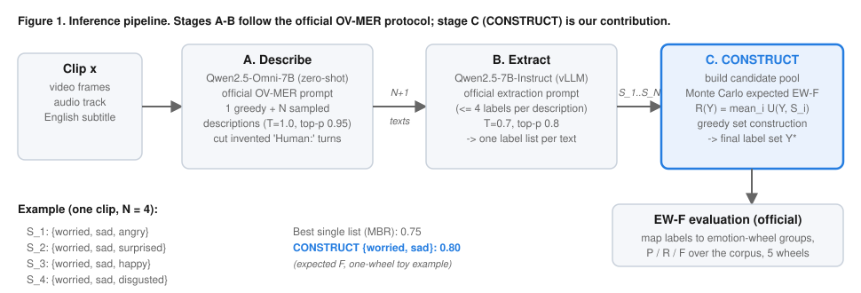
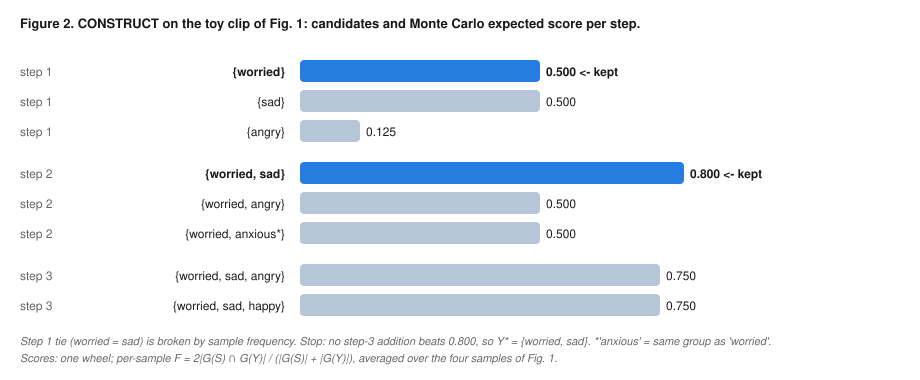
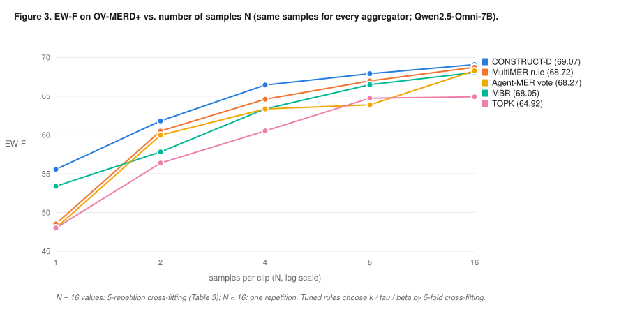
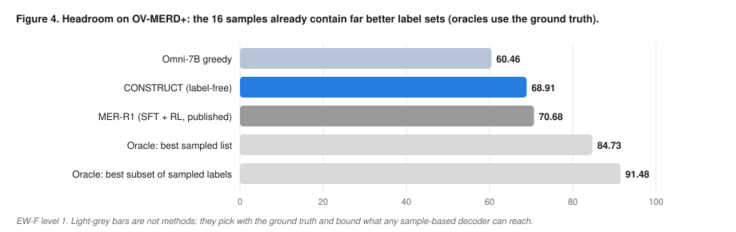

# From Samples to Sets: Training-Free Emotion-Wheel Decoding for Open-Vocabulary Multimodal Emotion Recognition

*Internal working draft, status as of 2026-11-25. All numbers are taken from the run reports in `explore/ovmer/`. Published numbers come from the full texts listed in `literature/reading_log.md`. The main experiment is still in progress (Section 6.6).*

---

## Abstract

Open-vocabulary multimodal emotion recognition (OV-MER) asks a multimodal large language model (MLLM) to describe the emotional state of a person in a video clip with a free set of emotion words. The benchmark scores the set with EW-F, an F-measure computed over emotion-wheel groups. Current methods produce one output per clip and close the gap to the metric by expensive reinforcement learning.

We observe a mismatch between how labels are generated and how they are scored:
- the model emits one token sequence, whereas the metric scores a **set**;
- the metric merges synonyms into one group, penalises extra groups (precision) and missing groups (recall), and averages over the corpus.

We propose **CONSTRUCT**, a training-free decoder that targets the metric directly. It works in three steps:
1. draw N label lists from the standard OV-MER pipeline;
2. estimate the expected EW-F of any candidate set by Monte Carlo over these lists;
3. *construct* a new label set by greedy expected-utility maximisation over the labels the lists contain.

**Results on OV-MERD+.** We use Qwen2.5-Omni-7B zero-shot and the official extractor; no OV-MERD+ label is used.
- CONSTRUCT raises EW-F from 60.46 (greedy) to **68.91** (+8.45, 95% CI [+6.34, +10.73]).
- This is above AffectGPT (62.52, SFT) and AffectGPT-R1 (68.39, SFT + RL), and below MER-R1 (70.68, SFT + RL).
- Compared on the same samples with the aggregation rules of the two most recent challenge winners, CONSTRUCT ties them at N = 16 and leads clearly at N ≤ 8.

**Headroom.** The best subset of the sampled labels reaches 91.48 (an oracle that sees the ground truth). The bottleneck is therefore the selection signal, not the coverage of the samples. We close with a concrete plan to address it.

---

## 1. Introduction

Multimodal emotion recognition is moving from classification over a fixed label set to *generative* emotion understanding. The MER2026 challenge summary (arXiv 2604.19417) describes the shift as "from discriminative emotion recognition to generative emotion understanding". In OV-MER [OV-MER, arXiv 2410.01495] the output for a clip is a free set of emotion words, for example {worried, tense}. It is scored with the emotion-wheel F-measure, **EW-F** (Section 3.2).

Two families of methods dominate the benchmark:

1. **Training the MLLM toward the metric.** AffectGPT (supervised fine-tuning, 62.52 on OV-MERD+), AffectGPT-R1 / -RL (adds GRPO, 68.39), and MER-R1 (separate recall and precision rewards, **70.68**, current state of the art). These require large compute; MER-R1 reports 16×H100 and about 18 h of RL.
2. **Aggregating several generations with hand-designed rules.** Agent-MER (MER2025 winner) keeps labels voted by at least k of N runs. MultiMER (MER2026 Track 2 winner) normalises words with 211 hand-written rules and keeps words above a tuned threshold.

**Our observation.** EW-F has three properties that a decoder can exploit without any training:
- (i) it scores **sets of emotion groups**, so synonyms earn nothing;
- (ii) it trades precision against recall;
- (iii) given a distribution over plausible answers, the Bayes-optimal output is the set with the **highest expected EW-F**, which is not necessarily any single generated answer.

Sample-based minimum Bayes risk (MBR) decoding estimates exactly this quantity. We adapt it to set-valued emotion outputs.

**Contributions.**
1. **CONSTRUCT:** a training-free, metric-derived set decoder for generative MER. It uses the emotion-wheel utility of the benchmark and constructs new sets rather than selecting among generated ones (Section 4).
2. **A controlled comparison under the official protocol.** Every aggregator (greedy, top-k, MBR, Agent-MER voting, MultiMER rules, CONSTRUCT) operates on the **same** samples, so differences isolate the decoding rule (Sections 5–6).
3. **An analysis of the bottleneck:** oracle headroom, noise in the samples, the cost–quality curve over N, and a concrete plan to move toward the ceiling (Sections 6–7).

---

## 2. Related Work

**Open-vocabulary MER with trained models.**
- **OV-MER** (arXiv 2410.01495) defines the task and the OV-MERD benchmark. OV-MERD+ (532 clips) is the version reported by later work.
- **AffectGPT** (ICML 2025) fine-tunes an MLLM on MER-Caption+.
- **AffectGPT-R1 / -RL** (arXiv 2508.01318, 2605.06126) adds GRPO with a metric-based reward.
- **MER-R1** (arXiv 2606.27652) decomposes the reward into recall and precision terms and calibrates "slow" against "fast" thinking.
- **HyDRA** (arXiv 2603.16463) learns a Propose–Verify–Decide reasoning schema with GRPO.

All of these change the model weights. CONSTRUCT is orthogonal: it can be applied to the outputs of any of them.

**Aggregating multiple generations in OV-MER.**
- **Agent-MER** (ACM MM 2025) runs N = 10 hierarchical deliberation passes and keeps labels that appear in at least k = 4 of them (k chosen on OV-MERD).
- **MultiMER** (ACM MM 2026) ensembles 26 voters. It normalises words with a hand-written NORM_MAP (211 rules), applies rank-decayed weighted voting on exact word matches, keeps words scoring at least τ·max (τ = 0.29), and clips the set to 3–6 words.

Both vote over **surface words**. Neither optimises the expected EW-F, nor uses the wheel structure to build the set.

**Test-time scaling for emotion.** arXiv 2602.03873 benchmarks best-of-N, log-likelihood-weighted aggregation and an external verifier (GPT-4o) for *ambiguous speech* emotion recognition on closed label sets (IEMOCAP, MSP-Podcast, CREMA-D). It is the closest precedent in affective computing for "sample, then aggregate". It differs from our setting: closed labels, speech only, a whole-answer verifier, and no metric-aware set construction.

**Verification in emotion understanding.** EmObserver (arXiv 2607.21061) recasts image affect as yes/no judgement of emotion statements, with training. arXiv 2610.31685 uses a critic and evidence checks to locate failures in an agent pipeline. The Emotional Rationale Verifier (arXiv 2510.23506) uses a verifier as an RL reward. None of them uses a model's own per-label judgement as a decoding signal, which is our next step (Section 7).

**MBR decoding** is an established decision rule in machine translation and text generation. *Specific references will be added after their full texts have been read; this draft does not cite from memory.*

---

## 3. Problem Formulation

### 3.1. Task and the standard pipeline

A clip $x$ consists of video frames, an audio track and a subtitle. The ground truth $Y^\star \subset \mathcal{V}$ is a set of free-form emotion words given by annotators. Its size varies across clips and datasets (Table 1).

The official evaluation code (`AffectGPT-RL/statistic.py`) produces a prediction in two stages:

$$d \sim p_\theta(\cdot \mid x) \quad\text{(MLLM writes an emotion description)}, \qquad L = \mathrm{Extract}(d) \quad\text{(LLM extracts a label list)}.$$

The prediction $L$ is then scored with EW-F.

### 3.2. Evaluation metric: EW-F

**Label mapping.** Each label is passed through three official lookup tables (`wheel_mapping.npz`):
1. surface normalisation, e.g. *worrying → worried*;
2. synonym grouping;
3. the level-1 group of emotion wheel $w$, for $w \in \{1,\dots,5\}$.

Labels outside the vocabulary are dropped; *neutral*, for instance, is not in the vocabulary. Let $G_w(Y)$ denote the set of wheel-$w$ groups of a label set $Y$.

**Per-clip precision and recall.** For clip $i$ and wheel $w$:

$$P_{i,w} = \frac{|G_w(Y^\star_i)\cap G_w(\hat Y_i)|}{|G_w(\hat Y_i)|},\qquad R_{i,w} = \frac{|G_w(Y^\star_i)\cap G_w(\hat Y_i)|}{|G_w(Y^\star_i)|}.$$

Clips with an empty $G_w(Y^\star_i)$ are skipped. An empty prediction gives $P = R = 0$.

**Corpus aggregation.**

$$\bar P_w = \frac1n\sum_i P_{i,w},\quad \bar R_w = \frac1n\sum_i R_{i,w},\quad F_w = \frac{2\bar P_w\bar R_w}{\bar P_w+\bar R_w},\qquad \text{EW-F} = \frac15\sum_w F_w .$$

Level 1 (coarse groups) is the reported metric; level 2 (finer groups) serves as a secondary check.

**Two properties matter for decoding.**
1. **Synonyms are free riders.** Adding *anxious* next to *worried* changes nothing, because both map to the same group.
2. **The metric is not a sum over clips.** $\bar P$ and $\bar R$ are averaged before the F-combination, so the marginal value of recall relative to precision is $\partial F/\partial \bar R \,/\, \partial F/\partial \bar P = (\bar P/\bar R)^2$. This ratio depends on the whole corpus (Section 4.5).

### 3.3. Decoding as expected-utility maximisation

Let $q(\cdot\mid x)$ be the distribution of label lists produced by running the pipeline with sampling. The decoding problem is

$$\hat Y = \arg\max_{Y} \; R(Y),\qquad R(Y) = \mathbb{E}_{Y' \sim q(\cdot\mid x)}\big[U(Y, Y')\big],$$

where $U$ is a per-clip surrogate of EW-F (Section 4.3).

$q$ stands in for the unknown distribution of the annotators' answer. This is the modelling assumption of sample-based MBR, and its failure mode is discussed in Section 6.5.

---

## 4. Method: CONSTRUCT

### 4.1. Overview



Stages A and B are the standard zero-shot OV-MER pipeline and contain nothing new. Stage C replaces "take the single output" with a decision rule derived from the metric.

### 4.2. Stages A–B: sampling label lists

**Stage A (describe).** Qwen2.5-Omni-7B (thinker only, bf16) receives:
- the frames and the audio track of the clip, with the audio interleaved with the video;
- the official Qwen2.5-Omni system prompt;
- the official OV-MER description prompt, with the English subtitle.

It produces one greedy description $d_0$ and $N$ sampled descriptions $d_1,\dots,d_N$ (temperature 1.0, top-p 0.95, at most 512 new tokens).

The model frequently continues its answer with an invented dialogue turn: "Human: …" appears in 44–73% of descriptions in a timing run of 21 clips. Each description is therefore cut at the first invented turn marker. This rule was fixed from structural statistics, before any score was computed.

**Stage B (extract).** Qwen2.5-7B-Instruct runs under vLLM with exactly the official settings:
- prompt of `reason_to_openset_qwen` in AffectGPT-RL, including "at most four labels";
- user message only; temperature 0.7, top-p 0.8, repetition penalty 1.05, at most 512 tokens;
- official post-processing; no translation.

The output is $N$ label lists $S_1,\dots,S_N$ (plus a greedy list $S_0$). Lists that are empty after extraction are dropped; let $N'$ be the number of non-empty lists.

### 4.3. Monte Carlo estimate of the expected score

**Per-clip utility.** For a candidate set $Y$ and a sampled list $S$:

$$U(Y,S) = \frac{1}{|\mathcal W_S|}\sum_{w\in\mathcal W_S}\frac{2\,|G_w(S)\cap G_w(Y)|}{|G_w(S)|+|G_w(Y)|},$$

where $\mathcal W_S$ is the set of wheels on which $S$ has at least one group. $U = 0$ if $Y$ maps to no group.

**Monte Carlo estimate.** Treating each sampled list as one plausible answer:

$$\hat R(Y) = \frac{1}{N'}\sum_{i=1}^{N'} U(Y, S_i).$$

This is an unbiased estimate of $\mathbb E_{q}[U(Y,\cdot)]$. Its variance shrinks as $1/N'$. All candidates are scored against the **same** samples, so the noise largely cancels when two candidates are *compared*.

### 4.4. Set construction

Classical sample-based MBR restricts the search to the sampled lists: $\hat Y = \arg\max_{Y\in\{S_0,\dots,S_N\}}\hat R(Y)$.

CONSTRUCT searches the much larger space of **sets assembled from the sampled labels**. Exhaustive search is exponential, so we use greedy forward selection:

```
Algorithm 1  CONSTRUCT (frozen settings: pool size M = 12, maximum set size K = 6)
Input : sampled label lists S_1..S_N', greedy list S_0, wheel mapping
1. pool  <- in-vocabulary labels of S_0..S_N', ranked by the number of lists containing them; keep the top M
2. Y <- {} ;  best <- -inf
3. while |Y| < K:
4.     for each label l in pool \ Y:  score(l) <- R̂(Y ∪ {l})        # Monte Carlo estimate, Sec. 4.3
5.     l* <- argmax_l score(l)
6.     if score(l*) <= best: break                                   # no candidate raises the expected score
7.     Y <- Y ∪ {l*};  best <- score(l*)
8. if Y is empty: Y <- most frequent pool label (or S_0)
Output: Y
```

The greedy loop gives the decoder three behaviours that voting rules lack:
- **Synonyms are skipped.** A second word from an already covered group leaves $\hat R$ unchanged and is never added.
- **The set size is chosen automatically.** The loop stops when the next label would lower agreement with the samples, so no k or τ is needed.
- **The consensus core is kept.** Idiosyncratic labels that appear in one sample only lower the agreement with the others and are dropped (Fig. 2).



In the toy clip of Fig. 1, all four samples agree on {worried, sad} and each adds a different idiosyncratic label. Every sampled list therefore contains one wrong label: the best one scores 0.75. CONSTRUCT returns {worried, sad}, a set that **no sample contains** and that scores 0.80.

**Cost.** Each greedy step evaluates at most $M$ candidates against $N'$ samples, i.e. $O(K\,M\,N')$ utility evaluations per clip. This is negligible next to the MLLM calls. The extra cost of the method lies in sampling: $N$ additional generated sequences per clip (Section 6.4).

### 4.5. Variant: CONSTRUCT-D (density-aware)

$U$ is an F1-type score, so it weighs precision and recall equally. The corpus metric does not (Section 3.2): its trade-off depends on how many labels the annotators give.

| | OV-MERD+ | MER2025-FG | EmoS-MELD |
|---|---|---|---|
| Ground-truth labels per clip | 3.84 | 6.23 | 1.34 |
| Labels per model sample | ≈ 2.5 | ≈ 2.5 | ≈ 2.5 |

CONSTRUCT-D makes three changes:
- replaces the F1 term in $U$ by $F_\beta = (1+\beta^2)\,|\cap| / (\beta^2|G_w(S)| + |G_w(Y)|)$;
- allows up to $K = 8$ labels;
- chooses $\beta \in \{0.5, 0.75, 1, 1.25, 1.5, 2, 2.5, 3, 4\}$ on labelled data, by 5-fold cross-fitting.

Because it uses labels, CONSTRUCT-D is reported as an analysis. The benchmark entry is the label-free CONSTRUCT.

---

## 5. Experimental Setup

### 5.1. Datasets

**Table 1.** Datasets.

| Dataset | Clips | Source | Ground truth | GT labels / clip | Role |
|---|---|---|---|---|---|
| **OV-MERD+** | 532 | Chinese TV series, MER2026 human-annotated pool | Open-vocabulary, human (`ovmerdplus-emotion.csv`) | 3.84 | **Benchmark**; compared with published results |
| **MER2025-FG** | 1,000 | Same pool, **0 clips overlap** with OV-MERD+ | Open-vocabulary, human (`mer2025ov1000-emotion.csv`; also the RL training data of AffectGPT-RL) | 6.23 | Development set for the next step |
| **EmoS-MELD** | 2,732 | MELD-train (US TV series); EmoS annotations (ACL 2026; "dual-layer human annotation") | Derived by us: GoEmotions labels with annotator share ≥ 0.5, without *neutral* and *unsure* | 1.34 (400-clip pilot sample) | Cross-domain generalisation |

Following the official dataset code (`ovmerdplus_dataset.py`, line 74), we use **English** subtitles. They exist for 510 of 532 (OV-MERD+) and 997 of 1,000 (MER2025-FG) clips; the remaining clips have no subtitle in either language.

### 5.2. Implementation

| Stage | Setting |
|---|---|
| Hardware | One A100 PCIe 40 GB (rented) |
| MLLM | Qwen2.5-Omni-7B thinker, bf16, transformers 5.24.0; audio read from the video track |
| Extractor | Qwen2.5-7B-Instruct on vLLM 0.34.0, official settings; fixed seed (0), plus a seed-1 re-extraction as a sensitivity check |
| Sampling | N = 16 samples per clip, generated as 2 calls × 8 sequences; one sample seed |
| Speed | About 46 s per clip for stage A |

The settings N = 16, M = 12 and K = 6 were fixed in the earlier pilot (Section 6.6) and have **not been tuned**.

### 5.3. Baselines (all on the same samples)

| Aggregator | Rule |
|---|---|
| **GREEDY** | the greedy list $S_0$; the usual zero-shot protocol |
| **TOPK** | the k most frequent labels, k = median sample length |
| **MBR** | the sampled (or greedy) list with the highest $\hat R$ |
| **Agent-MER vote** | labels present in ≥ k samples; k ∈ {1..16} chosen by cross-fitting, or the paper's 40% threshold |
| **MultiMER rule** | NORM_MAP, rank-decayed voting, keep ≥ τ·max, clip to [3, 6]; τ = 0.29 (paper) or τ chosen by cross-fitting; also a variant without the clip |

For MultiMER we use one model, so all voters carry the same weight. We also disable its training-vocabulary boost, because that vocabulary overlaps the evaluation sets.

### 5.4. Statistics

- Paired bootstrap over clips: 2,000 draws, 95% percentile intervals.
- Parameters of tuned aggregators are chosen by **5-fold cross-fitting**, repeated with 5 fold seeds, so that every clip is scored by a parameter chosen without its own label.
- The full protocol and decision rules are pre-registered in `explore/ovmer/p17_score.py`.

---

## 6. Results

### 6.1. Comparison with published results on OV-MERD+

**Table 2.** OV-MERD+, EW-F level 1. Our rows use no OV-MERD+ label.

| System | Training | Label read-out | EW-F |
|---|---|---|---|
| Qwen2.5-Omni-7B zero-shot, greedy (ours) | none | LLM extractor | 60.46 |
| **Qwen2.5-Omni-7B zero-shot + CONSTRUCT (ours)** | none | LLM extractor | **68.91** |
| AffectGPT | SFT, 7B | LLM extractor | 62.52 |
| AffectGPT-R1 / -RL | SFT + RL, 7B | `<answer>`, then LLM extractor | 68.39† |
| MER-R1 | SFT + RL, Qwen2.5-Omni (size not reported) | `<answer>` read directly | **70.68** |

† Maximum over the checkpoints of epochs 5–60, each evaluated on OV-MERD+ (`AffectGPT-RL/statistic.py`). MER-R1 reports its final checkpoint.

**Sensitivity of the CONSTRUCT row to the extraction step:**

| Extraction | EW-F |
|---|---|
| Seed 0 (main) | 68.91 |
| Seed 1 | 69.01 |
| Older prompt without the four-label limit | 69.13 |

**Reading.** Decoding alone adds 8.45 points to the zero-shot model and places a training-free system above both AffectGPT models. It remains 1.77 points below MER-R1.

### 6.2. Decoders on the same samples

**Table 3.** OV-MERD+, N = 16, identical samples for every row. Tuned rules use 5-fold cross-fitting with 5 repetitions.

| Aggregator | Uses labels | EW-F | CONSTRUCT-D − row [95% CI] |
|---|---|---|---|
| GREEDY | no | 60.46 | +8.61 [+6.52, +10.89] |
| TOPK | no | 64.92 | +4.15 [+2.73, +5.62] |
| MBR | no | 68.05 | +1.02 [+0.01, +2.03] |
| **CONSTRUCT** | **no** | **68.91** | +0.16 [−0.54, +0.88] |
| MultiMER rule, τ = 0.29 (paper) | no | 68.92 | — |
| Agent-MER vote, 40% threshold (paper) | no | 44.82 | — |
| Agent-MER vote, k cross-fitted (k = 2) | yes | 68.27 | +0.80 [−0.30, +1.97] |
| MultiMER rule, τ cross-fitted (τ = 0.4) | yes | 68.72 | +0.35 [−0.65, +1.38] |
| MultiMER rule without clip, τ cross-fitted | yes | 69.04 | +0.03 [−0.94, +1.00] |
| CONSTRUCT-D, β cross-fitted (β = 1.25) | yes | 69.07 | — |

**Label-free comparisons with CONSTRUCT:**

| CONSTRUCT − X | Difference [95% CI] |
|---|---|
| GREEDY | +8.45 [+6.34, +10.73] |
| TOPK | +3.99 [+2.72, +5.30] |
| MBR | +0.87 [+0.16, +1.61] |
| MultiMER rule, τ = 0.29 | −0.01 [−1.28, +1.19] |

**Reading.**
1. Constructing sets beats selecting a sample (MBR) significantly, and beats frequency top-k by about 4 points.
2. **At N = 16 the strongest prior aggregation rule (MultiMER) ties CONSTRUCT.** This holds whether its threshold is the published one or chosen with labels.
3. Agent-MER's published threshold (4 of 10 runs) does not transfer to these 16 diverse samples. With a cross-fitted k it is close to the others.
4. The CONSTRUCT-D − Agent-MER difference is significant with the seed-1 extraction (+1.25 [+0.17, +2.41]) and with the older prompt (+1.36 [+0.22, +2.53]), but not with seed 0.

### 6.3. Sample efficiency



**Table 4.** Values plotted in Fig. 3 (EW-F on OV-MERD+).

| N | 1 | 2 | 4 | 8 | 16 |
|---|---|---|---|---|---|
| CONSTRUCT-D | **55.56** | **61.80** | **66.44** | **67.90** | **69.07** |
| MultiMER rule | 48.52 | 60.50 | 64.60 | 66.97 | 68.72 |
| MBR | 53.38 | 57.81 | 63.36 | 66.48 | 68.05 |
| Agent-MER vote | 48.00 | 59.97 | 63.35 | 63.88 | 68.27 |
| TOPK | 48.00 | 56.37 | 60.52 | 64.74 | 64.92 |

**Reading.**
- CONSTRUCT-D leads at every budget. Its margin is largest when samples are scarce: +1.8 over MultiMER at N = 4, +0.9 at N = 8.
- With 4 samples, CONSTRUCT-D (66.44) is within 0.5 points of MultiMER with 8 samples (66.97).
- Returns diminish for every method: going from 8 to 16 samples adds about 1.2 points to CONSTRUCT-D.

### 6.4. Cost

**Per clip:**
- stage A decodes 17 sequences (1 greedy + 16 sampled, in 3 generation calls), about 46 s on one A100;
- stage B runs 17 short extraction prompts, batched in vLLM.

Trained systems (AffectGPT, MER-R1) decode **one** sequence per clip, but pay the training cost up front (e.g. 16×H100 and about 18 h of RL for MER-R1). The time of a single greedy pass has not yet been measured separately. The final paper will report EW-F against generation time, i.e. Fig. 3 on a cost axis.

### 6.5. Where the remaining error comes from



**Table 5.** Oracle analysis on OV-MERD+. The oracles use the ground truth; they are bounds, not methods.

| Selection | EW-F |
|---|---|
| CONSTRUCT (label-free) | 68.91 (P 69.4 / R 68.5) |
| Oracle: best single sampled list per clip | 84.73 |
| Oracle: best subset of the sampled labels per clip | **91.48** |

In 93.8% of (clip, wheel) pairs, the pooled samples contain at least one correct group. **The samples cover the answer; the decoder's selection signal is the bottleneck.**

**Noise in the samples (OV-MERD+, structure only):**

| Quantity | Value |
|---|---|
| Non-empty samples per clip | 14.0 of 16 on average (minimum 7) |
| Distinct labels outside the wheel vocabulary (dropped) | 25.6% |
| In-vocabulary labels that appear in only 1 of 16 samples | 61.8% |
| Clips with more than M = 12 candidate labels | 71.8% (mean 15.6) |
| Labels selected from pool ranks 10–12 | 41 |
| Selected labels that appear in only 1 sample | 10.5% |

**Interpretation.** The samples feed into $\hat R$ in three ways, each with a different effect:
1. **Pure-noise samples** score close to 0 against every candidate, so they mostly shrink the effective $N'$ and leave the ranking of candidates almost unchanged.
2. **Partly noisy samples** (a correct core plus a spurious label) shift the preferred **set size**.
3. **Systematic errors** (the model's prior repeatedly produces the same wrong label) **bias** $\hat R$, because $q \neq p$. Increasing N cannot remove this bias.

Two design weaknesses are also visible:
- **The pool is ranked by surface-word frequency**, but the utility is defined on groups. A group expressed by several different words, each seen once, can fall outside the top 12; labels at rank 12 are still being selected.
- **The per-clip F1 utility cannot see the corpus-level precision/recall trade-off.** In the 3B pilot on MER2025-FG (dense ground truth) this made CONSTRUCT precision-heavy (P 73 / R 60), which CONSTRUCT-D corrects.

### 6.6. Pilot with Qwen2.5-Omni-3B (three datasets)

An earlier pilot ran on Kaggle T4 GPUs with a protocol that differs from the official one: Chinese subtitles, a 4-bit extractor, Chinese-to-English label translation, and descriptions cut at the first line. It is valid for comparing decoders, not for comparing with published numbers.

**Table 6.** Pilot, EW-F level 1.

| Dataset | GREEDY | TOPK | MBR | CONSTRUCT | CONSTRUCT − TOPK | CONSTRUCT − MBR |
|---|---|---|---|---|---|---|
| OV-MERD+ | 58.64 | 66.27 | 68.00 | 69.27 | +3.00 [+1.75, +4.22] | +1.27 [+0.54, +2.07] |
| MER2025-FG | 50.95 | 58.43 | 63.02 | 66.04 | +7.61 [+6.51, +8.80] | +3.02 [+2.35, +3.75] |
| EmoS-MELD (400) | 56.29 | 57.65 | 59.13 | 59.55 | +1.89 [+0.46, +3.42] | +0.42 [−0.62, +1.46] |

**Against the prior aggregation rules on the same pilot samples:**
- CONSTRUCT beat them on OV-MERD+ (+1.1 to +1.2) and EmoS-MELD (+1.6 to +2.1).
- It lost to the MultiMER rule on MER2025-FG (−1.73 [−2.65, −0.85]), the dense-ground-truth set.
- CONSTRUCT-D removed that loss: +1.02 [−0.00, +2.14] against the better calibrated rule (30% calibration, 70% test, 20 splits).

**Status of the main experiment.** The pre-registered decision of the main experiment is a **pooled** test over the three datasets with the 7B model. It has not been run yet: by decision, stage A was stopped after OV-MERD+ until the method is improved on a development set (Section 7).

---

## 7. Limitations and Next Steps

**Validity rule for all items below.** Every design choice and hyper-parameter will be fixed on the **development set MER2025-FG**, pre-registered, and then evaluated **once** on OV-MERD+. Nothing is tuned on the benchmark.

1. **Self-verification of candidate labels (main next step).**
   - For each pool label $l$, ask the same MLLM, with the clip, "Is the person feeling *l*? Answer yes or no." Read $P(\text{Yes})$ from the logits.
   - Combine this *discriminative* signal with sample consensus in CONSTRUCT.
   - It targets the gap between 68.91 and 91.48 directly. It costs one prompt-processing pass per candidate (about 10 per clip) and no generation; the time is to be measured.
   - A first novelty sweep (arXiv; 21 queries; 6 full texts) found no prior use of this kind in affective computing. OpenAlex and snowballing are pending.
2. **Cleaning the samples that act as answers.** Each sample currently weighs $1/N'$ in $\hat R$, noisy or not. Options:
   - (a) weight samples by their agreement with the other samples;
   - (b) drop labels with low $P(\text{Yes})$ inside each sample;
   - (c) weight samples by the $P(\text{Yes})$ of their labels;
   - (d) subtract the model's label prior, estimated without labels from label frequencies over all clips. This targets the systematic bias of Section 6.5, which more samples cannot remove.
3. **Group-level candidate pool.** Rank candidates by support of their emotion **group**, or drop the cap M (the mean pool size is only 15.6).
4. **Label-free precision/recall balance.** Estimate $\bar P / \bar R$ without labels, to replace the labelled choice of β in CONSTRUCT-D.
5. **Hyper-parameters (N, M, K) on the development set**, reported as cost–quality curves (EW-F against generation time).
6. **Model-versus-decoder control.** Apply CONSTRUCT to the public AffectGPT SFT checkpoint on OV-MERD+, the same model as the published 62.52 baseline.
7. **Generalisation and variance.** After OV-MERD+ succeeds: run EmoS-MELD (cross-domain) and the pre-registered pooled test, plus 3 sample seeds on OV-MERD+ (mean ± sd).
8. **Related work.** Read and cite the MBR literature in machine translation; repeat the arXiv novelty check around 2026-12-20.

**Immediate action.** Generate stage-A descriptions for MER2025-FG (about 12.5 GPU-hours, about 9 USD), then develop items 1–4 on that set.

---

## 8. Conclusion

Generative emotion recognizers are trained to emit one sequence, but they are judged on sets of emotion groups. CONSTRUCT closes part of this gap without training. It estimates the expected benchmark score of candidate label sets from the model's own samples and builds the best set greedily. With a zero-shot 7B model it reaches 68.91 on OV-MERD+, above both AffectGPT models and 1.77 below the RL-trained state of the art. It matches the best published aggregation rule at 16 samples and beats it when samples are few. The 91.48 oracle shows that the samples already contain much better answers. The next step is therefore a stronger selection signal, for which we propose the model's own per-label verification.

---

## References (verified; full text read)

| Reference | Venue / ID |
|---|---|
| OV-MER: Towards Open-Vocabulary Multimodal Emotion Recognition | arXiv 2410.01495 |
| AffectGPT: A New Dataset, Model, and Benchmark for Emotion Understanding with MLLMs | ICML 2025 |
| AffectGPT-R1: Leveraging RL for OV-MER | arXiv 2508.01318 |
| AffectGPT-RL: Revealing Roles of RL in Open-Vocabulary Emotion Recognition | arXiv 2605.06126 |
| MER-R1: Multimodal Emotion Reasoning via Slow-Fast Thinking Synergy | arXiv 2606.27652 |
| Agent-MER: A Cognitive Agent with Hierarchical Deliberation for OV-MER | ACM MM 2025, doi:10.1145/3746027.3762011 |
| MultiMER: Vocabulary-Aligned Multi-Model Ensemble for Fine-grained Emotion Recognition | ACM MM 2026, doi:10.1145/3767308.3838611 |
| Decoding Ambiguous Emotions with Test-Time Scaling in Audio-Language Models | arXiv 2602.03873 |
| HyDRA: Hybrid-evidential Deductive Reasoning in OV-MER | arXiv 2603.16463 |
| MVEI & EmObserver: Emotion Statement Judgement | arXiv 2607.21061 |
| An Agentic Approach with Evidence-Grounded Verification for Multimodal Emotion Reasoning in Conversation | arXiv 2610.31685 |
| Emotion-Coherent Reasoning for MLLMs via Emotional Rationale Verifier | arXiv 2510.23506 (AAAI 2026) |
| EmoS: A High-Fidelity Multimodal Benchmark for Fine-grained Streaming Emotional Understanding | ACL 2026 (github.com/NLP2CT/EmoS) |
| MER 2026 challenge summary | arXiv 2604.19417 |

*Figures are generated by `reports/make_figures.py` from the aggregate numbers above.*
